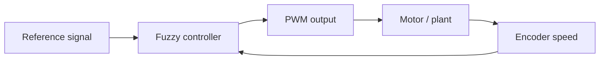

# Fuzzy Controller for ESP32

**A fuzzy-logic speed-control experiment using encoder feedback and PWM actuation.**

## Contents

- [Overview](#overview)
- [Control loop](#control-loop)
- [Controller configuration](#controller-configuration)
- [Hardware pinout](#hardware-pinout)
- [Requirements](#requirements)
- [Setup](#setup)
- [Tuning and validation](#tuning-and-validation)
- [Limitations](#limitations)
- [License](#license)

## Overview

FUZZY_Controller is an ESP32-based fuzzy-logic control experiment. The sketch measures motor speed from encoder pulses, calculates a control signal with a fuzzy controller, and updates a PWM output.

The repository separates fuzzy-logic and reference-signal code under `src/`.

## Control loop

## Controller configuration

The sketch currently defines:

| Parameter | Value |
|---|---:|
| PWM frequency | 1 kHz |
| PWM resolution | 10 bits |
| Sampling interval | 80 ms |
| Encoder pulses per revolution | 3 |
| Reference profile | Triangular wave |
| Number of fuzzy rules | 5 (via `N_Regras`) |

Membership-function centers and bases are initialized directly in `FUZZY_Controller.ino`. These values are experimental and should be tuned for the actual motor, sensor, and load.

## Hardware pinout

| Signal | ESP32 GPIO |
|---|---:|
| Motor PWM | 25 |
| Motor direction | 33 |
| Encoder input | 22 |

Verify the motor driver, encoder voltage, common ground, and supply requirements before connecting the hardware.

## Requirements

- ESP32 development board
- DC motor and suitable motor driver
- Encoder
- Arduino IDE or compatible ESP32 toolchain

## Setup

1. Clone the repository.
2. Open `FUZZY_Controller.ino`.
3. Install/select ESP32 board support.
4. Inspect the source files in `src/`.
5. Confirm pin assignments and electrical limits.
6. Compile and upload to the selected board.

The sketch uses ESP32 LEDC APIs whose availability can vary between Arduino-core versions. Confirm compatibility with your installed core.

## Tuning and validation

Tune membership-function centers and bases against the target plant. Record reference speed, measured speed, control output, sampling period, and load conditions for each test.

## Limitations

This repository documents an experimental controller, not a general-purpose certified control library. Stability and performance depend on the physical system and must be validated before deployment.

## License

This project is licensed under the **GNU General Public License v3.0 only (GPL-3.0-only)**. You may use, study, modify, and redistribute this project under the terms of the license.

See [LICENSE](LICENSE) for the complete license text. Third-party components and assets remain subject to their own licenses and notices.
